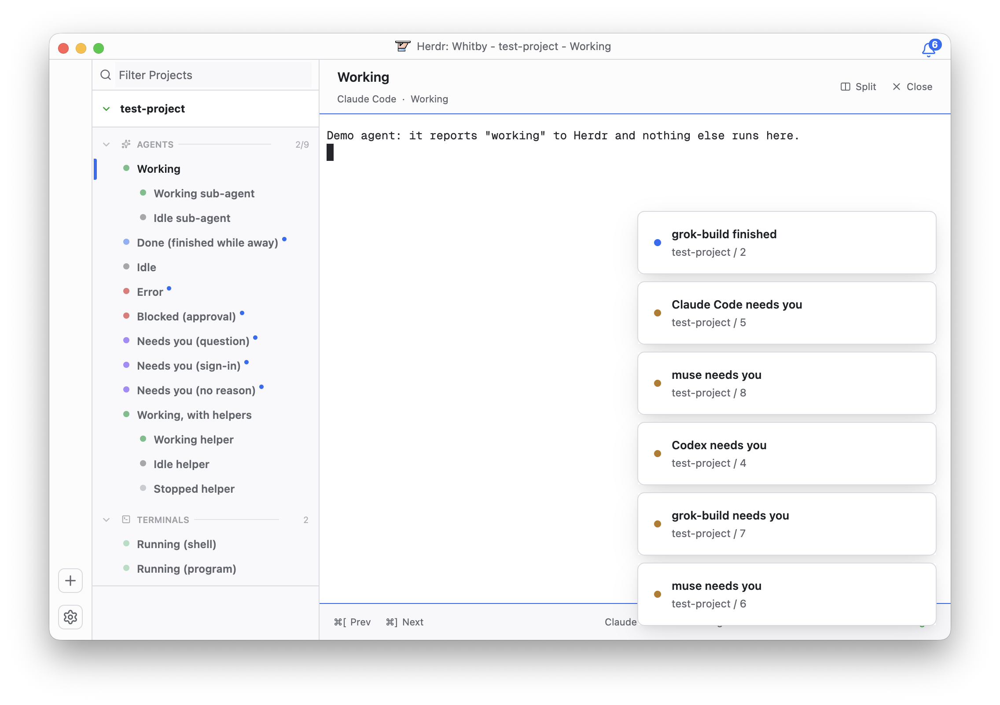

# Whitby for Herdr

https://github.com/user-attachments/assets/2cde7bac-219a-4fae-af91-7bd3a1419120

<p align="center">
  
</p>

A [Herdr](https://herdr.dev) layout that takes its inspiration from [Solo](https://soloterm.com): a
calm, light project sidebar where each agent shows its state at a glance, an attention bell for
the ones that want you, and an agent page with a header and a status footer around the terminal.
It's built from Herdr's own parts (a layout file, one mod and two themes), so your spaces, tabs
and terminals are all still Herdr's.

Version 0.1.0.

## Features

- **Projects sidebar.** Each Herdr space is a project with a folding header, and its tabs sit
  under **Agents** and **Terminals** with counts. A **Filter Projects** field narrows the list. A
  `+` appears on a section's header when you hover it, and an empty section offers to add one.
  The selected row gets a blue bar that slides from row to row.
- **Status dots.** A pulsing green dot means working, green means running, blue means done
  (finished while you were away), grey means idle and light grey means stopped. Solid red is an
  error, pulsing red is blocked on an approval, and pulsing purple needs you (a question, a
  sign-in or no reason given).
- **Nested sub-agents.** Agents an agent starts nest under it, whether it started them as
  terminals (`hc run`) or reports them as helpers (Claude Code's subagents). Hover a parent to
  fold them; folded, it reads "(+2 subagents)".
- **Unread dots and the attention bell.** An agent that finished, is blocked, needs you or failed
  is unread until you look at it, and carries a small blue dot. The bell in the top-right corner
  counts them; click it to go to the most urgent one.
- **Agent page.** A header with the agent's name and "tool · state", plus Split, Zoom and Close.
  A footer with your own Prev/Next keys and the agent's tool, sub-agent count, CPU, memory and
  state.
- **Resource badges.** CPU and memory badges on rows and project headers once they cross
  Whitby's thresholds: 30% CPU or 500 MB for an agent, 25% or 1 GB for a project.
- **Readable titles.** It trims what agents add to their titles, such as Grok's " - grok",
  Codex's " | folder" and Muse's bare folder name. While Grok works, its row keeps its last real
  title instead of "Waiting for response...".
- **Projects page.** With no spaces open, the work area shows a Projects page. Its Add project
  row opens a folder picker, and it lists your Herdr shortcuts.
- **Small touches.** The title bar reads "Herdr: Whitby - project - agent". Hovering a project
  header shows Reveal in Finder. The rail buttons and the bell fade on hover. Light and dark
  themes follow your system appearance.

## Install

Ask your Herdr agent to add `herdr.dev/layouts/shellscape/herdr-whitby`, or copy the files into
Herdr's home yourself:

```sh
git clone https://github.com/shellscape/herdr-whitby
cd herdr-whitby
cp layouts/whitby.json layouts/whitby.svg ~/.config/herdr-app/layouts/
cp themes/whitby-light.json themes/whitby-dark.json ~/.config/herdr-app/themes/
cp -R mods/whitby ~/.config/herdr-app/mods/
herdr-app check ~/.config/herdr-app/mods/whitby
herdr-app do layout.switch --name whitby
```

Press `ctrl-shift-l` to cycle back to your own layout. Your layout stays as it was; deleting
these files removes Whitby.

The two theme files matter: the layout names them for light and dark, and the usual
layout-install steps (a layout file plus its mods) don't copy `themes/`.

What the mod does beyond drawing: while the window is in front it runs `ps` every 3 seconds for
the CPU and memory figures, and Reveal in Finder runs `open` on the project's folder. It reads no
files outside its folder and makes no network requests.

## Develop

```
layouts/whitby.json   the window: title bar, rail, sidebar, and the agent page or Projects page
layouts/whitby.svg    the picture Herdr's settings show for the layout
themes/               the light and dark themes: Whitby's palette and terminal colors
mods/whitby/          one mod; props.part picks what each block draws
  main.js             picks the part: titlebar, rail, sidebar, header, footer, home
  kit.js              palette, titles, states, unread, sub-agents, CPU and memory
  sidebar.js          the projects sidebar and its status dots
  titlebar.js bell.js the title bar and the attention bell
  rail.js             the rail and its buttons (and the hover/press layers the bell uses too)
  header.js footer.js the agent page's header and footer
  home.js             the Projects page
RECIPE.md             the brief Herdr's community format asks for: what to build, exactly
scripts/              the demo
```

### Try it without touching your own Herdr

```sh
scripts/demo.sh          # a second Herdr window with this layout and demo agents in every state
scripts/demo.sh stop
```

The demo has its own Herdr home and its own herdr-core session, so it can't change your spaces,
terminals or settings. The agents are small scripts (`scripts/fake-agent.sh`) that report a
status and nothing else. `DEMO_SIZE=1023x689` sets the window size and `DEMO_SIDEBAR=257` the
sidebar's width; `DEMO_DIR` moves it. Keep that path short, because Herdr talks over unix
sockets inside it. The README screenshot is this demo.

Herdr reloads a mod when you save it. To work on a running demo, edit its copy in
`$DEMO_DIR/app/mods/whitby` (or copy yours over it), then check it and look at it:

```sh
export HERDR_APP_HOME=$DEMO_DIR/app
herdr-app check $HERDR_APP_HOME/mods/whitby
herdr-app shot                                # the window's last frame, as a PNG
herdr-app do layout.switch --name main && herdr-app do layout.switch --name whitby   # start the mod fresh
```

### Things that will bite you

- **Tooltips take the pointer.** On the element that handles hover, `on_hover` never fires; on
  a layer above a button, presses never reach it. Put the tooltip on a wrapper.
- **Transitions need ids.** A fade only runs on an element with an `.id()`, since that's how a
  transition follows it from frame to frame.
- **Hover and press.** On the element that takes the press, a press dragged off and released
  elsewhere never reports the pointer leaving. So hover is tracked on an outer element, and the
  pressed fill is GPUI's own `.active()` style, which ends on a release anywhere.
- **Hit areas.** A block can't draw outside itself, and a hit area hanging past its edge lets the
  pointer leave without the block noticing. Overlay windows are kept back from the window's
  edges, so they can't sit tight in a corner.
- **No nulls.** `.child(null)` breaks a render; use `.children([])` or `.when()`.
- **What herdr gives a layout.** `terminals()` leaves finished terminals out, so a finished
  `hc run` sub-agent can't be shown as stopped. Helper records' titles arrive decoded, but
  programs send them base64.

### Contributing

Issues and pull requests are welcome. Keep [RECIPE.md](RECIPE.md) in step with what the layout
does, since Herdr's agents build from it. Check the mod with `herdr-app check`, and look at the
change in the demo in both light and dark before sending it.

## License

[MPL 2.0](LICENSE). The icons in `mods/whitby/icons/` are [Lucide](https://lucide.dev) (ISC,
[LICENSE.lucide](mods/whitby/icons/LICENSE.lucide)). The mark and the platter drawing are
Whitby's own artwork, shared here under the same license.
