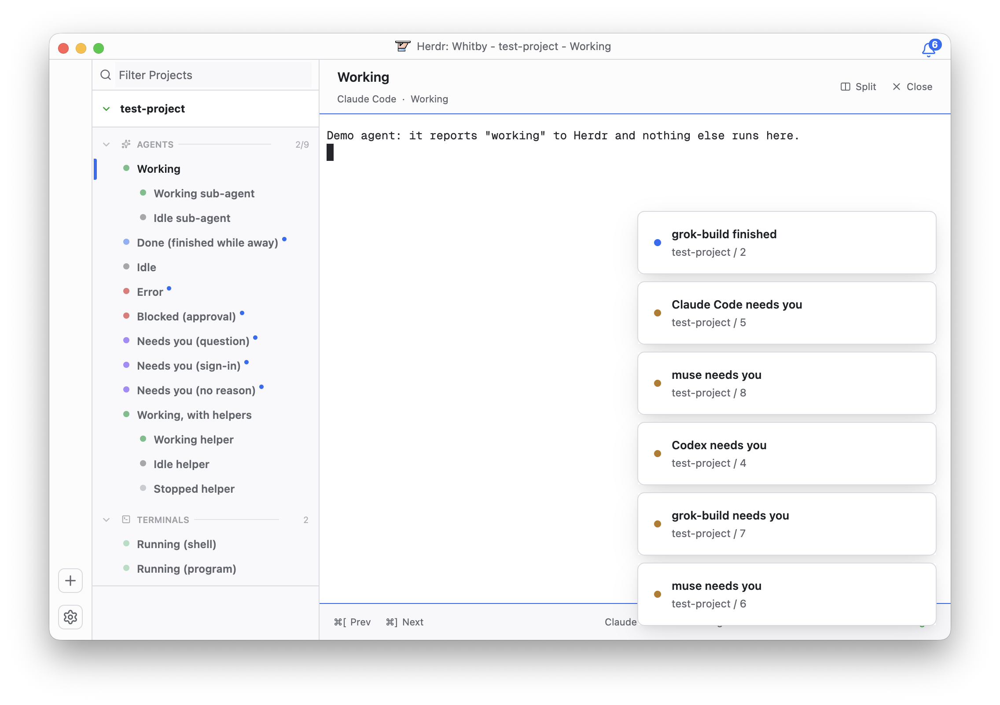

# Whitby

A calm, light workspace inspired by Solo. Your spaces become projects in a tidy sidebar, and
every agent wears a soft dot: green while it works, purple when it needs you, red when it's
stuck. Agents they start nest underneath. A blue bell counts whatever is waiting on you, and the
agent you're on fills the rest of the window.

## What you see

- **Title bar**, 30 px, full width, on `canvas` (`#fcfcfd` light, `#111113` dark), with a 1 px
  `border` line under it. macOS window buttons sit at `[9, 9]`. Two 224 px slots flank a centered
  caption: the 19.5×14 px Whitby mark (`mods/whitby/whitby.svg`), 6 px gap, then
  "Herdr: Whitby - {space} - {tab title}", or "Herdr: Whitby - Projects" with no spaces. The
  caption is 12.25 px, weight 500, `muted`. While the window is in the background the bar is at
  72% opacity (120 ms).
- **Attention bell**, in the title bar while any agent is unread: an 18 px bell 10 px from the
  window's top and 16 px from its right. Its body is `#ffffff` (`#18191b` dark) inside a
  `#246cf4` outline. A blue badge (min 14 px, 10.5 px semibold white, `9+` past nine) overlaps
  the bell's top-right.
- **Rail**, 48 px, on `canvas`, with two buttons at the bottom: `+` (new space) and a gear
  (settings). Each button is 28 px, radius 7, a 1 px `border`, with an 18 px `muted` glyph.
- **Projects sidebar**, 192 px (180–352), on `chrome` (`#f9f9fb` / `#18191b`):
  - A 35 px filter row: a 14 px search icon and a 13 px "Filter Projects" field on `#f8f8fa`.
  - Per space, a 42 px project header on `#ffffff` with a bottom line and a light shadow. It has
    a 10.5 px chevron (40% `muted`, green `#189a30` while an agent works) and the name at
    12.25 px bold. Badges, when shown, are 10 px `muted`.
  - The project body on `#f9f9fb` (`#111113`), 5.25 px top and bottom, holds two sections.
    **AGENTS** holds tabs with an agent status; **TERMINALS** holds the rest.
  - A section header is 28 px (7 px above the second): a chevron, a 10.5 px icon (sparkles or a
    terminal square) at 60%, the uppercase label at 10 px semibold 60% `muted`, a 1 px rule at
    15%, a `+` that shows on hover, and a count at 50%. Agents count as "working/total".
  - Rows are 28 px, title text from 31.5 px: a 14 px slot with a 7 px status dot, then the title
    at 12.25 px semibold, `muted` (`foreground` when selected). Sub-agents indent 19.25 px per
    level. An empty section shows a 10.5 px "+ Add agent" or "+ Add terminal".
  - The selected row has a 3.5 px blue bar, 85% of the row tall, at the sidebar's left edge.
- **Agent header**, 62 px: the title at 15 px semibold, "{tool}  ·  {state}" under it at 11 px
  `muted`, and Split, Zoom (when split) and Close on the right (13 px icon, 11 px label). Its
  bottom line is blue while a terminal has focus.
- **Terminal**, Geist Mono 13 px, padding 8 px. Split panes have a 1 px gap and an `accent`
  outline on the focused one.
- **Footer**, 42 px, `#f8f8fa` (`#202632`), 11 px `#60646c`, with a top line blue while focused.
  On the left are the keys bound to `agent.prev` and `agent.next` ("⌘[ Prev", "⌘] Next"). On the
  right are the tool name (a shell shows its title), "+N sub-agents", "CPU x.x%" and
  "MEM N MB" (from 700 px wide), and the state with its dot.
- **Projects page**, instead of the agent page, while there are no spaces. It's a centered
  column up to 406 px:
  - A folder icon and "Projects" (14 px semibold).
  - "All the projects loaded in Herdr." (12.25 px, 70% `muted`) and "0 projects".
  - A rounded card (radius 7, `#e0e1e6` line) with an "Add project" row: a 14 px `+` at 45%,
    and an arrow that fades in on hover.
  - The platter drawing behind the card at 5% opacity, 120% of the column wide.
  - A right-aligned legend of bound shortcuts (10.5 px; keys in Menlo).
- **Themes** `whitby-light` / `whitby-dark`, from Whitby's palette and terminal ANSI colors.

## How it behaves

- **Status dots** (7 px, nudged up 1 px):

  | State | Dot |
  |---|---|
  | working | `#6cbf8a`, pulsing between 35% and 100% over 1.6 s |
  | running (a live terminal with no agent status) | `#6cbf8a` at 50% |
  | done | `#8ab0f7` |
  | idle | `muted` at 55% |
  | stopped (a finished helper) | `muted` at 30% |
  | error | `#e5787a` |
  | blocked on an approval (kind `permission`) | `#e5787a`, pulsing |
  | needs you (a question, `auth`, or no kind) | `#a78bfa`, pulsing |

  An error is read from the terminal's own status word, since herdr's agent lists say blocked.
- **Unread.** An agent that's done, blocked, needs you or errored is unread until you look at it
  in that state. Each unread row has a 5 px `#246cf4` dot after its title. The bell counts them;
  clicking it focuses the most urgent (error, blocked, needs you, done). What's read is kept in
  `shared("whitby.read")`.
- **Sub-agents.** A terminal's sub-agents (`hc run` children) and its helper records (OSC 7501
  records, as Claude Code's subagents) list under it. A sub-agent's done shows idle; a finished
  helper shows stopped. Hovering a parent shows a fold chevron, and folded it reads
  "(+N subagents)". Clicking a sub-agent shows it in its tab's pane in place of the parent's
  terminal, and the blue bar, header and footer follow it; clicking a helper shows its agent.
  Clicking the parent's row, or Close in the header, brings the parent back.
- **Rows.** Click selects the space and tab. Right-click opens herdr's tab menu, or its space
  menu on a project header. The project chevron folds a project, and a section's chevron folds
  the section; folds persist. The blue bar slides to the selected row in 200 ms. Hovering a
  project header shows an 18 px Reveal in Finder button.
- **Titles.** A named tab keeps its name. Otherwise a row shows its agent's title, minus a
  leading spinner or emoji and a trailing " - {app}", " - {app's first word}" or
  " | {folder}". A title that's only the folder, the program or the terminal address gives way to
  the program's name. While a title ends in "...", the row keeps the last real title.
- **Badges.** Process CPU and memory come from `ps` every 3 s while the window is in front. A
  row shows CPU at 30% or more and memory at 500 MB or more; a project shows 25% and 1 GB.
- **Hover and press.** Rail buttons fade their `hover` fill and their glyph (`muted` to
  `foreground`) over 150 ms, and show `foreground` at 8% while pressed. The bell fades its body
  to light blue (`#c6d8fc`; `#4a6aa8` dark), and shows blue at 14% while pressed.
- **Projects page.** It appears when the last space closes and goes when one opens. Add project
  opens the folder picker and starts a space in the chosen folder.

## Built from

- **Layout tree** (`layouts/whitby.json`), a root column with `titlebar: "none"`, the themes
  `{light: whitby-light, dark: whitby-dark}`, `font: "Geist Mono"`, `font_size: 13`,
  `ui_font: ".SystemUIFont"` and `terminal_padding: [8, 8]`:
  - `titlebar`: a 30 px `window_drag` block.
  - `body`: a row with a 1 px `border` divider, holding:
    - `rail`, 48 px.
    - `sidebar`, 192 px.
    - `work`, a stack (active `agent` or `home`):
      - `agent`: a column of `agent-header` (62 px), `main` (`{tab: "active"}`, pane gap 1,
        radius 0, `focus` accent, block background `border`) and `agent-footer` (42 px).
      - `home`: the Projects page.
  Every block but `main` is the mod `whitby` with `props.part`: `titlebar`, `rail`, `sidebar`,
  `header`, `footer` or `home`.
- **Mod** `mods/whitby` (`place: "none"`):
  - `main.js` dispatches on `props().part`.
  - `kit.js`: palette, title cleanup, states, unread, sub-agents, CPU and memory.
  - `sidebar.js` also switches the `work` stack with `layout.select` and marks read.
  - `bell.js` is drawn by `titlebar.js`.
  - `rail.js` exports the hover, press and tooltip helpers the bell uses.
- **herdr API** used: `spaces`, `panes`, `terminals`, `agents`, `focused`, `layout`, `keys`,
  `theme`, `settings`, `window`, `shared`, `setShared`, `exec`, `pickFolder`, `openOverlay`,
  `run`, `home`.
  - Commands: `space.select`, `tab.select`, `tab.new`, `space.new`, `pane.focus`,
    `terminal.show`, `pane.split`, `pane.zoom`, `pane.close`, `layout.select`, `app.settings`.
  - Shipped mods: `menu`, `new-menu`, and `mods/pane/split-right.svg`.
- **Programs**: `ps -axo pid=,ppid=,pcpu=,rss=`, and `open {folder}`.
- **Art**: Lucide icons (ISC) in `mods/whitby/icons/`, plus a filled bell made from Lucide's
  bell. `whitby.svg` (the mark) and `platter.svg` are Whitby's drawings.
  `layouts/whitby.svg` is the settings preview.

## Watch out

- Copy `themes/` too; without it the layout falls back to Herdr's default theme.
- Tooltips take pointer events. Wrap the control: `.tooltip()` on the hovered element stops
  `on_hover`, and on a layer above the control it swallows presses.
- `.transition()` only animates elements with an `.id()`.
- On the element that takes a press, a press dragged off and released elsewhere never reports
  the pointer leaving. Track hover on an outer element, and draw the pressed fill with
  `.active()` on the topmost layer, which also takes `on_click`.
- A control inside a clickable row (a fold chevron, Reveal in Finder) acts on `on_mouse_down`
  and stops propagation there; with `on_click`, the row takes the click instead.
- Keep hit areas inside their block. The bell's 24×22 px target ends at y=29, inside the
  30 px title bar, so leaving downward reports. Overlay windows can't sit closer than about 25 px to the window's right edge.
- `.child(null)` breaks rendering; use `.children([])`.
- `terminals()` omits finished terminals, so finished `hc run` sub-agents disappear rather than
  show stopped.
- A layout switch starts every mod copy fresh. After live edits, switch away and back if a copy
  keeps old state.

## Done when

- `herdr-app check mods/whitby` passes, and `layout.switch {name: "whitby"}` shows the title bar,
  rail, sidebar, header, terminal and footer with no entries in `herdr-app status` errors.
- `scripts/demo.sh` shows each state's dot as listed, two sub-agents and three helpers nested
  under their agents, unread dots on the six agents that want attention, and a bell reading 6.
- Hovering a rail button fades it in and out. Pressing it, dragging off and releasing elsewhere
  leaves it at rest. Hovering the bell fades it light blue, and moving down off it fades it back.
- Clicking the bell focuses an unread agent and its dot goes; the bell's count drops.
- Closing every space shows the Projects page; opening one brings the agent page back.
- Light and dark appearance both use the Whitby themes.
